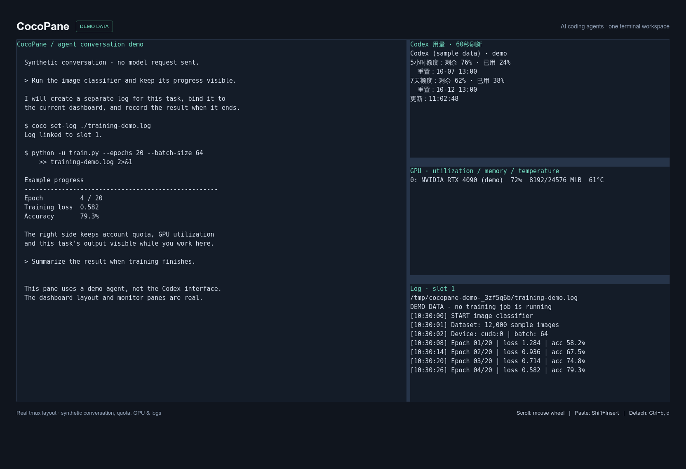

# CocoPane

[English](README.md)

给 AI 编程助手配一个终端工作台。

在服务器终端中，把 Codex / Claude、账号额度、GPU 和任务日志放进同一个 tmux 窗口。
左侧对话占 60%，右侧监控占 40%；无需 pip 包、网页服务或管理员权限安装 coco。



上图由真实 tmux 会话的布局和面板输出渲染而成；对话、额度、GPU 和日志使用演示数据。
左侧为示例对话，不是 Codex 原生界面，也不代表真实模型任务已通过验证。

## 安装前准备

- Linux / WSL2、Bash 4+、Python 3.9+、tmux 3.0+、GNU coreutils。
- 自行安装并登录 Codex 或 Claude Code；coco 不包含账号，也不代替 CLI 登录。
- 终端最少 80×24，建议 120×40。NVIDIA GPU 可选，没有显卡也可以使用。

Ubuntu/Debian/WSL 缺少依赖时：

```bash
sudo apt update
sudo apt install tmux python3 bash coreutils
```

CLI 安装参考 [Codex 官方说明](https://learn.chatgpt.com/docs/developer-commands?surface=cli)
和 [Claude Code 官方说明](https://code.claude.com/docs/en/setup)。
CLI 兼容检查使用 Codex 0.160.1、Claude Code 2.1.207。
此版本实际验证的平台是 Linux；WSL2 使用同一套 Linux 工具，但尚未在 Windows 主机实测。
暂不支持原生 Windows 和 macOS。

## 三步开始

克隆源码并安装：

```bash
git clone https://github.com/hefengcs/cocopane.git
cd cocopane
./install.sh
export PATH="$HOME/.local/bin:$PATH"
coco doctor
```

如果拿到的是压缩包，先执行 `tar -xzf cocopane-0.1.0.tar.gz`，
再 `cd cocopane-0.1.0`，然后运行以上安装步骤。

切换到你自己的工作目录，再运行：

```bash
coco open                 # 默认 Codex
coco claude               # Claude
```

安装器仅复制程序到 `~/.local/share/cocopane`，创建 `~/.local/bin/coco`。
不会修改 shell 启动文件、CLI 全局配置或研究项目说明文件。
需要长期使用时，将上面的 PATH 设置自行加入 shell 配置。

如果已存在同名命令，安装器会拒绝覆盖。可以选择独立位置：

```bash
./install.sh --prefix "$HOME/.local/coco-preview"
"$HOME/.local/coco-preview/bin/coco" doctor
```

也可免安装：`./monitor/coco open`。安装检查不会访问你的账号或发起模型请求。

## 使用

```bash
coco open --resume                 # 恢复会话选择器
coco open --continue               # 继续最近会话
coco open --no-gpu --no-usage       # 只保留对话和日志
coco open --detach                 # 后台创建，输出连接命令
coco status
coco kill                          # 只列出会话
coco kill 会话名称                  # 停止指定会话及其面板
```

保留 CLI 原有认证、权限确认和沙箱设置。只有显式传 `--unsafe` 才跳过 CLI 权限保护。
监控日志目录通过 `--add-dir` 加入允许访问的目录，使模型可以维护日志链接。
Claude 正常加载配置，不使用 `--bare`。自动分配空闲槽位，显式指定已占用槽位会报错。

默认使用独立的 `coco-public` tmux 服务，不连接默认 tmux 或其他旧版 coco 服务。
`coco kill --all` 只终止该服务中的 `coco-*` 会话。

- `Ctrl+b` 后按 `d`：暂时离开，任务继续。
- `Ctrl+b` 后按 `o`：切换面板。
- 滚轮：查看所在面板历史；按 `q` 返回输入。
- `Ctrl+b` 后按 `[`：用键盘查看历史。
- Xshell：用 `Shift+右键` 或 `Shift+Insert` 粘贴。

Xshell 的会话属性 → 终端 → 高级，需要启用“按 SHIFT 键时限制应用程序鼠标模式”；
鼠标右键动作设为粘贴。其他终端使用各自的本地粘贴快捷键。
`Ctrl+b` 后按 `m` 仍可作为备用鼠标捕获开关。

## 日志与自动维护规则

每次新建或恢复会话时，会把当前槽位、日志目录和维护规则传给模型。
规则要求模型为长任务创建独立日志、绑定面板、记录真实进度和结束结果；
这只是工作约定，不是自动任务调度器，也无法保证模型从不遗漏。
GPU 和 Codex 用量面板由程序自行刷新。

在该会话的 shell 环境中可手动绑定：

```bash
mkdir -p logs
job_log="$PWD/logs/my-run.log"
touch "$job_log"
coco set-log "$job_log"
python -u your_script.py >>"$job_log" 2>&1
```

从别的终端绑定时需要 `coco set-log --slot N 日志路径`。
模型拿到的指令包含完整路径和槽位，即使工具环境没有继承变量，也能绑定到正确面板。
`COCO_LOG_PATH` 是入口链接，不能把它当成新任务日志去截断或覆盖。

Codex 用量是账号共享额度，非当前会话 token 计数。每 60 秒读取一次真实额度和重置时间，
失败时明确提示旧数据，不发起模型推理。API-key / 第三方账号可能不返回此额度，
可用 `--no-usage` 隐藏。较旧 Codex 缺少配置读取接口时，可更新 CLI 或使用 `--no-instructions`。

规则文件：`monitor/AGENT_PANEL_INSTRUCTIONS.md`。修改后新建/恢复的会话生效。

## 配置与卸载

| 环境变量 | 用途 |
|---|---|
| `COCO_DATA_DIR` | 状态目录，默认 `~/.local/state/cocopane`，支持 `XDG_STATE_HOME` |
| `COCO_LOG_DIR` | 日志链接和任务元数据目录，默认状态目录下的 `logs` |
| `COCO_TMUX_SOCKET` | 独立 tmux 服务名称，默认 `coco-public` |
| `COCO_CWD` | 启动目录，默认当前目录 |
| `CODEX_BIN` / `CLAUDE_BIN` | CLI 可执行文件绝对路径，默认从 PATH 查找 |

环境变量正常传给 CLI，认证值不写入启动命令或 coco 配置文件。
卸载（如需结束任务，请先退出对应会话）：

```bash
python3 "$HOME/.local/share/cocopane/install.py" --uninstall
```

自定义安装位置时，传入原来的 `--prefix`。卸载保留日志、账号和正在运行的会话。
升级时先卸载旧副本，再安装新源码。

## 验证与打包

```bash
python3 -m unittest discover -s monitor -p 'test_*.py'
python3 -m unittest discover -s tests -p 'test_*.py'
python3 tools/package.py
```

重新生成截图：安装 Chrome/Chromium 后运行 `python3 tools/screenshot.py`。
脚本使用独立 tmux 服务、临时 HOME 和演示程序，不读取你的账号或发起模型请求。
浏览器仅为此文档工具所需，日常使用 CocoPane 无需安装。

集成测试使用临时 HOME、临时安装目录、假 CLI 和独立 tmux 服务，不调用真实模型。
独立发行版尚未使用真实账号完成从启动到任务结束的完整验证；WSL2 尚未实测。
`ci/github-actions.yml` 提供 Python 3.9 / 3.12 的 GitHub Actions 模板。
将它复制到 `.github/workflows/tests.yml`，使用具有工作流写入权限的凭证推送即可启用。
首次上传未启用 GitHub 自动测试。
打包产物位于 `dist/`，仅包含代码、测试和文档，不包含个人日志、账号或历史对话。
MIT 许可证；这是独立社区工具，与 OpenAI、Anthropic 无隶属关系。
